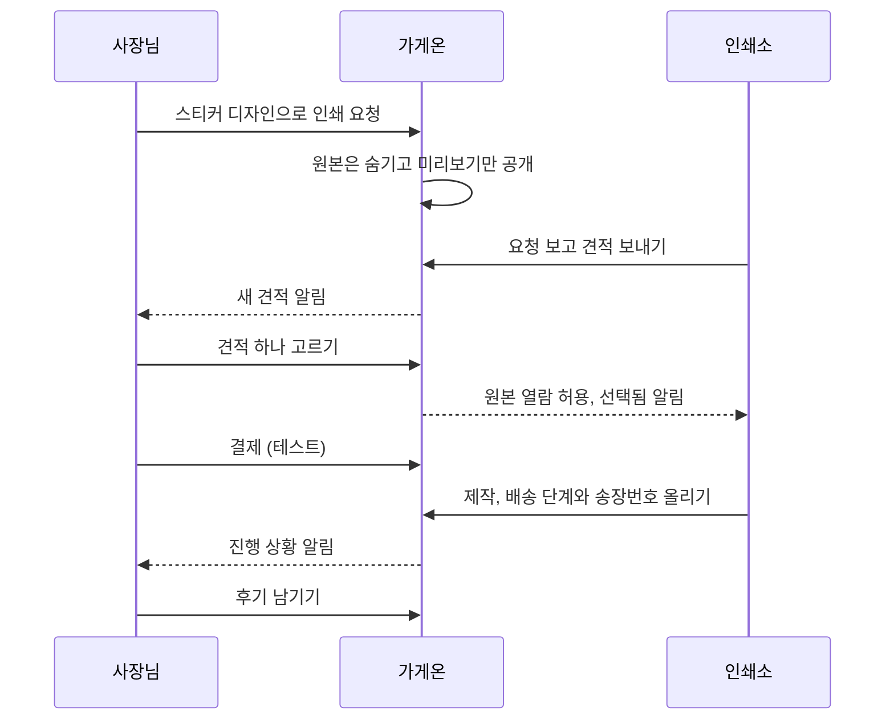

# saerogochim
제2회 영남대 SW중심대학 융합그룹 창업 해커톤 - 새로고침

## 가게온

동네 가게 사장님용 웹앱.
AI로 가게 캐릭터, 스티커를 만들고 근처 인쇄소에 바로 제작을 맡김.

- **사장님**: 가게 정보 입력 → AI 캐릭터, 슬로건 → 스티커 꾸미기 → 인쇄 요청 → 견적 고르기 → 결제 → 진행 상황 확인
- **인쇄소**: 가입, 관리자 승인 → 새 요청 찾기 → 견적 보내기 → 제작, 배송 상황 올리기

## 둘러보기

[가게온 체험 사이트](https://saerogochim.vercel.app/)

- **소상공인으로 둘러보기**: 받은 견적, 제작 진행 사례
- **인쇄소로 둘러보기**: 새 요청 찾기, 보낸 견적, 수락된 의뢰

체험 사이트 AI 버튼은 목업임. 3초 정도 만드는 척하고 예시 캐릭터를 보여줌.
AI는 부를 때마다 돈이 나감. 그래서 실제 생성은 노트북에서 서버 켰을 때만 됨([실행 방법](#실행-방법)).

## 만든 것

**캐릭터, 스티커**

- 가게 이름, 위치, 업종, 분위기, 손님층, 자랑거리를 단계별로 입력. 업종은 자유 입력.
- AI가 슬로건 1줄, 추천 색 4개, 키워드 4개, 캐릭터 그림을 만듦.
- 경산시 동을 고르면 같은 업종 가게 수, 주변 가게 이름에 많이 쓰인 말을 보여줌. 공공데이터 상가 정보 사용.
- 한글 문구 넣어서 스티커 꾸미기, 포장 미리보기, PNG 다운로드.
- 입력 내용 자동 저장. AI 생성 중에 창 닫으면 경고.

**인쇄소 연결**

- 사장님이 요청 올림 → 인쇄소들이 견적 보냄 → 사장님이 하나 고름.
- 디자인 원본은 고른 인쇄소만 봄. 그 전엔 워터마크 미리보기만 보임.
- 1:1 채팅, 사진 전송. 새 메시지, 새 견적은 새로고침 없이 바로 뜸.
- 접수, 제작, 배송 단계별 날짜와 송장번호 기록.
- 토스 테스트 결제. 진짜 돈은 안 나감.
- 거래 끝나면 후기 작성 → 인쇄소 평점으로 모임.
- 주소는 카카오 우편번호 검색.

**계정, 관리자**

- 사장님 계정, 인쇄소 계정 따로 가입. 브랜드는 계정별 저장.
- 새 인쇄소는 바로 견적 못 보냄. 관리자가 국세청에서 사업자 상태(영업, 휴업, 폐업) 확인하고 승인해야 함.
- 관리자 화면에서 계정 목록 보기, 탈퇴 처리([ADMIN.md](ADMIN.md)).
- 남의 요청, 견적은 DB에서부터 막음. 화면에서만 숨긴 게 아님.

**그 밖에**

- 휴대폰 홈 화면에 앱처럼 설치 가능(PWA). 인터넷 끊기면 안내 띠 뜸.
- 삭제 같은 되돌릴 수 없는 버튼은 확인 창 한 번 거침.
- OpenAI, Gemini 그림을 이름 가리고 비교하는 스크립트 있음(`scripts/compare_images.py`).
- main에 올리면 팀 디스코드로 알림 감.

## 할 것 (우선순위 순)

시연 코앞이라 시연에 영향 있는 것부터.

**1. AI 생성 실제로 돌려 보기 (제일 급함)**

- 코드는 다 있는데 진짜 유료 API로 돌려 본 적 없음.
- 체험 사이트는 목업이라 시연 때는 노트북에서 서버 직접 켜야 함.
- OpenAI 계정에 결제 수단 등록, 잔액 충전.
- 3번 이상 실제로 만들어 보고 걸리는 시간 재 두기. 오래 걸리면 기다리는 동안 할 멘트 준비.

**2. 휴대폰으로 처음부터 끝까지 확인**

- 시작 화면부터 스티커 다운로드까지 끊김 없이 3번 연속 되는지 보기.
- 오프라인 안내 띠, 삭제 확인 창도 같이 눌러 보기.

**3. 폰 푸시 알림 → 시연 뒤로 미룸**

- 앱 닫아 둬도 새 견적, 채팅 오면 폰에 알림 뜨는 기능.
- 코드는 거의 다 됨. Supabase 설정이랑 테스트가 남음.
- 사흘 남았는데 건드리다 딴 데 깨지면 안 되니까 시연 끝나고 함.

**시연 끝나고**

- **AI 서버 온라인에 올리기**: 지금은 내 노트북에서만 돌아감. 로그인한 사람만 쓰게 막고 1인당 금액 한도 걸어야 함. 지금 한도(그림 20번, 문구 60번)는 횟수라 금액은 못 막음.
- **진짜 결제**: 지금은 토스 테스트 모드.
- **캐릭터 서버 저장**: 지금은 브라우저에만 저장됨. 다른 기기에선 안 보이고 큰 그림은 저장 공간 모자랄 수 있음.

## 쓴 외부 서비스 (API)

로그인, 결제, 주소 검색 같은 건 직접 안 만들고 있는 서비스 가져다 씀.

| 서비스 | 하는 일 |
|---|---|
| OpenAI (이미지) | 캐릭터 그림. 기본 모델 `gpt-image-2.5-flare` |
| OpenAI (글) | 슬로건, 추천 색, 키워드. 기본 모델 `gpt-4.1-mini` |
| Google Gemini | 서비스엔 안 씀. OpenAI 그림이랑 비교할 때만 |
| Supabase | 회원가입, 로그인, 데이터, 사진 저장, 실시간 채팅. 서버 직접 안 만들려고 씀 |
| 국세청 사업자 상태조회 (공공데이터포털) | 인쇄소가 진짜 영업 중인지 확인 |
| 소상공인 상가정보 (공공데이터포털) | 주변 가게 분석. 파일로 받아서 `data/gyeongsan-stores.json`에 넣음 |
| 토스페이먼츠 | 결제 (테스트 모드) |
| 카카오 우편번호 | 주소 검색 |

AI 키, 국세청 키는 브라우저에 안 둠. 노트북 서버나 Supabase 서버에만 둠.
브라우저에 두면 누구나 키 빼 가서 우리 돈으로 AI 씀.

**노트북 AI 서버 요청** (`server.py`)

| 주소 | 하는 일 |
|---|---|
| `GET /api/status` | AI 키 있는지, 남은 횟수 |
| `POST /api/brand` | 슬로건, 색, 키워드 만들기 |
| `POST /api/generate` | 캐릭터 그림 만들기 |

같은 요청 두 번 와도 돈 두 번 안 나가게 요청마다 번호로 확인함. 그림은 한 번에 하나씩만 만듦.

## 구조도

**전체 그림**

웹사이트는 Vercel. 로그인, 데이터, 채팅은 Supabase. AI 그림은 시연 때 노트북 서버 거쳐서 OpenAI로.


직접 눌러 보면서 보려면 [architecture.html](architecture.html) 받아서 브라우저로 열기.

**인쇄 요청부터 제작까지**



**폴더 구조**

```text
index.html        껍데기 (파일 불러오기만 함)
app.js            화면 로직 (캐릭터 만들기, 마이페이지 등)
style.css         화면 스타일
assets.js         예시 캐릭터 그림 (SVG)
print.js          인쇄 요청, 견적, 결제, 진행 상황, 관리자
chat.js           1:1 채팅
config.js         Supabase 주소 (공개해도 되는 값만)
sw.js             휴대폰 앱 설치, 오프라인 처리
server.py         내 노트북 AI 서버
supabase/         데이터베이스 표, 권한 규칙, 서버 함수
data/             경산시 상가 데이터
scripts/          상가 데이터 변환, 그림 비교, 관리자 계정 만들기
test_server.py    AI 서버 테스트
```

DB 설정은 `supabase/`에 실행 순서대로 번호 붙어 있음(`01_schema.sql` ~ `11_reviews.sql`).

## 실행 방법

Python 3.10 이상만 있으면 됨. 따로 설치할 패키지 없음.

```powershell
python server.py
```

- 키 물어보면 OpenAI API 키 붙여 넣기. `OPENAI_API_KEY` 환경변수로 넣어 둬도 됨.
- 키 없이 Enter 누르면 예시 모드.
- 브라우저로 [127.0.0.1:8000](http://127.0.0.1:8000) 접속. `index.html` 더블클릭으로 열면 AI 서버랑 연결 안 됨.
- 부를 때마다 요금 나가니까 OpenAI 계정에 결제 수단, 잔액 필요.

테스트:

```powershell
python -m unittest -v test_server.py
```

## 쓴 기술

- 화면: HTML, CSS, JavaScript (프레임워크 없음), Pretendard 글꼴, [Astryx](https://github.com/meta/astryx) 테마 색
- 서버, 데이터: Supabase (PostgreSQL), Python 표준 라이브러리 AI 서버
- 배포: Vercel, GitHub Actions (디스코드 알림)

## 문서

- [SERVER.md](SERVER.md): AI 서버 켜는 법, 한계
- [ADMIN.md](ADMIN.md): 관리자 계정, 인쇄소 승인, 국세청 확인, 푸시 알림 설정
- [PROTOTYPE.md](PROTOTYPE.md): 프로토타입 범위
