# saerogochim
제2회 영남대 SW중심대학 융합그룹 창업 해커톤 - 새로고침

## 가게온

동네 가게 사장님용 웹앱.
가게 이야기를 몇 가지 고르면 AI가 우리 가게 캐릭터를 그려 주고, 그 캐릭터로 스티커·포장·홍보물을 만들어 근처 인쇄소에 바로 맡길 수 있음.

[가게온 체험 사이트](https://saerogochim.vercel.app/)에서 로그인 화면 아래 **소상공인**, **인쇄소** 버튼을 누르면 가입 없이 써 볼 수 있음. 휴대폰에서는 홈 화면에 추가하면 앱처럼 열림.

## 한눈에 보기

### 1. 시작

| 첫 화면 | 로그인 | 홈 |
|:---:|:---:|:---:|
| 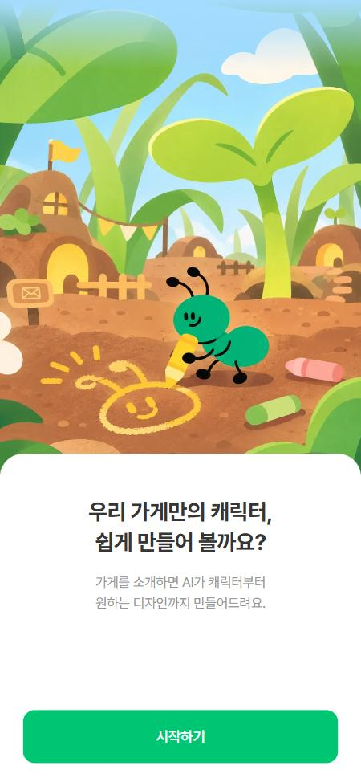 |  |  |
| 시작하기를 누르면 그림이 걷히며 로그인 화면으로 넘어감 | 아이디·비밀번호, 아래는 가입 없이 쓰는 체험 계정 버튼 | 캐릭터 만들기, 인쇄소 찾기, 최근 작업 |

### 2. 캐릭터 만들기

| 분위기 고르기 | 취향 (색·질감) | 그리는 중 |
|:---:|:---:|:---:|
| 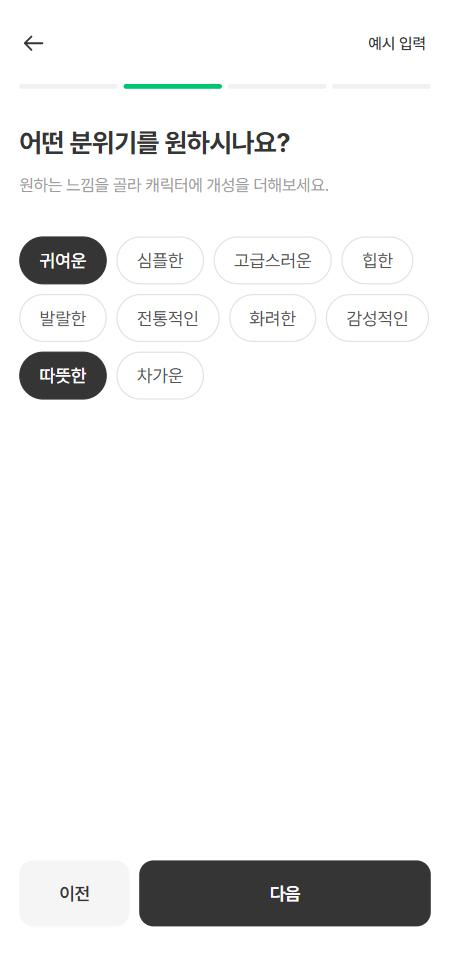 | 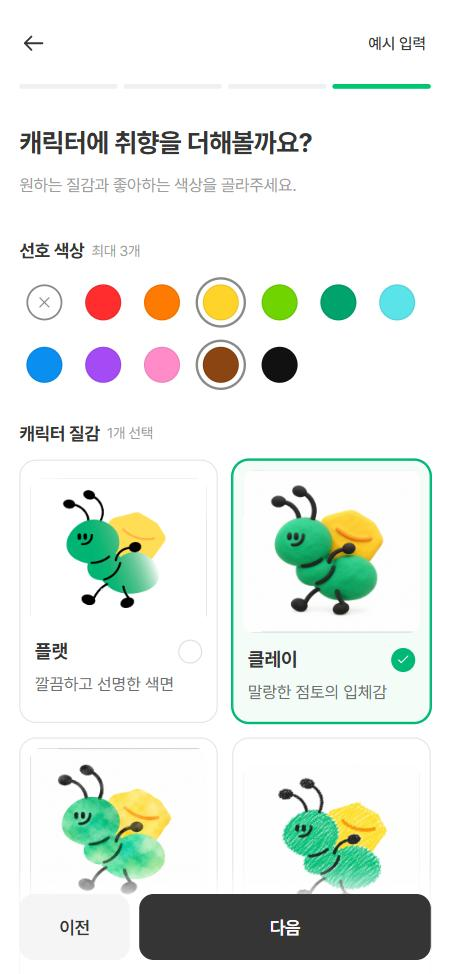 | 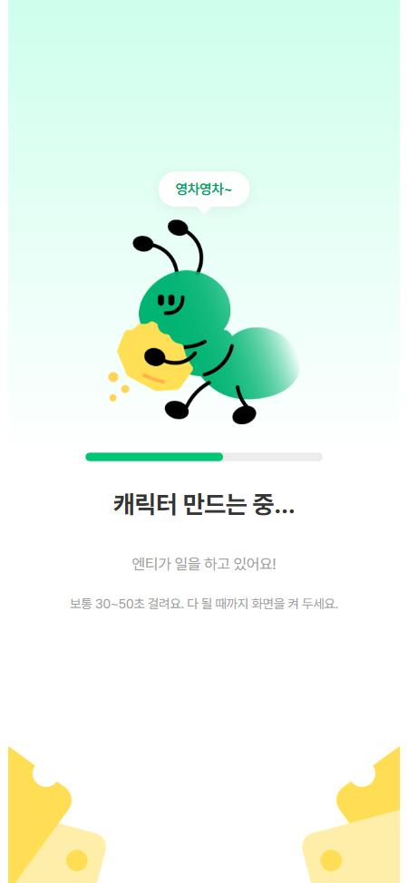 |
| 질문은 4단계: 가게 소개 → 분위기 → 특별한 점 → 취향 | 색은 최대 3개, 질감은 플랫·클레이·수채화·크레용·펠트·연필 중 하나 | 개미 엔티가 일하는 로딩 화면 (보통 30~50초) |

| 브랜드 분석 | 스티커 편집 | 결과물 |
|:---:|:---:|:---:|
| 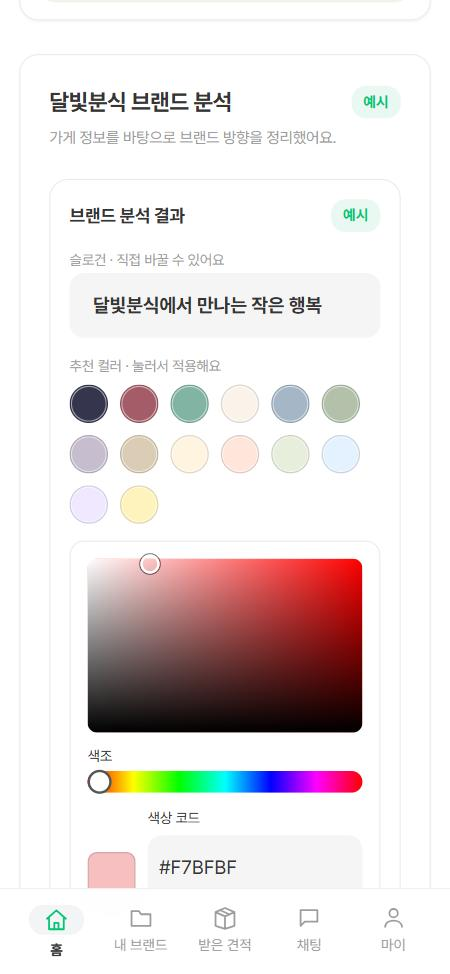 |  | 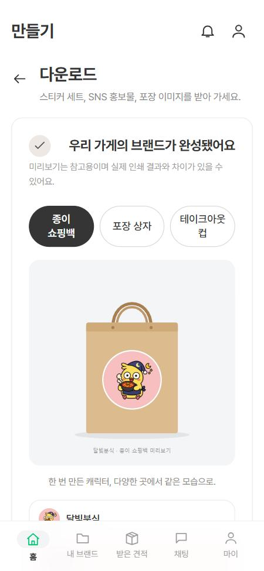 |
| AI가 만든 슬로건과 추천 색, 색은 직접 바꿀 수 있음 | 캐릭터·상호명·문구를 끌어 옮기고 크기·회전 조절, 글꼴 12종 | 스티커 세트, 쇼핑백·상자·컵 포장, SNS 홍보물을 PNG로 받음 |

### 3. 인쇄 맡기기

| 인쇄 파일 만들기 | 인쇄 탭 | 견적 비교 |
|:---:|:---:|:---:|
| 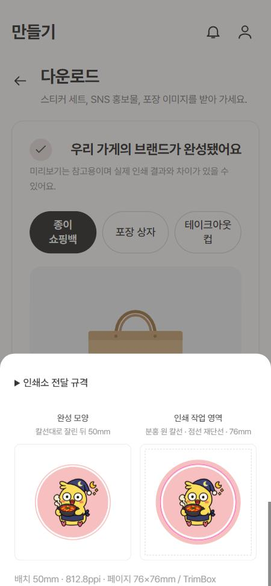 |  | 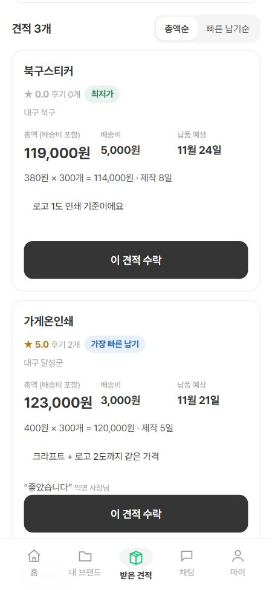 |
| 50mm 원형 스티커 인쇄용 PDF를 자동으로 만들고 확인 후 승인 | 진행중 주문은 전달 → 제작중 → 도착 단계가 깜빡이며 표시 | 인쇄소별 금액·납기·별점, 최저가와 가장 빠른 납기 표시 |

| 주문상세 | 채팅 | 마이페이지 |
|:---:|:---:|:---:|
| 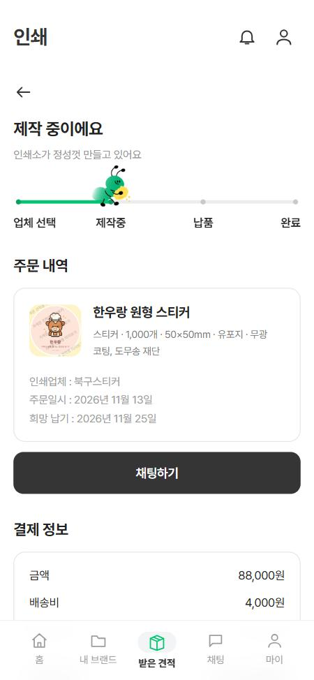 | 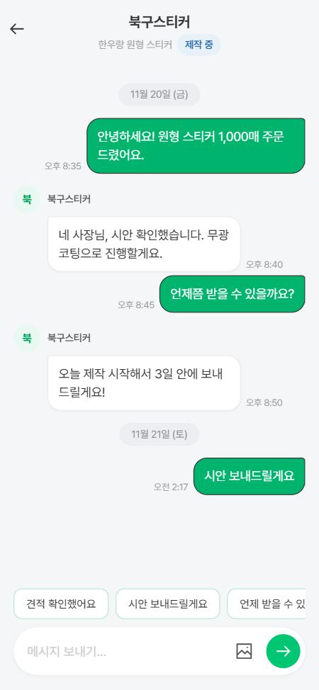 |  |
| 개미가 지금 단계 위에 서 있는 진행 막대, 주문 내역, 결제 정보 | 고른 인쇄소와 1:1 채팅, 첫 대화 전에는 자주 묻는 질문 칩 | 남은 온, 요금제, 온 충전, 구매·배송 내역 |

### 4. 시즌 시안

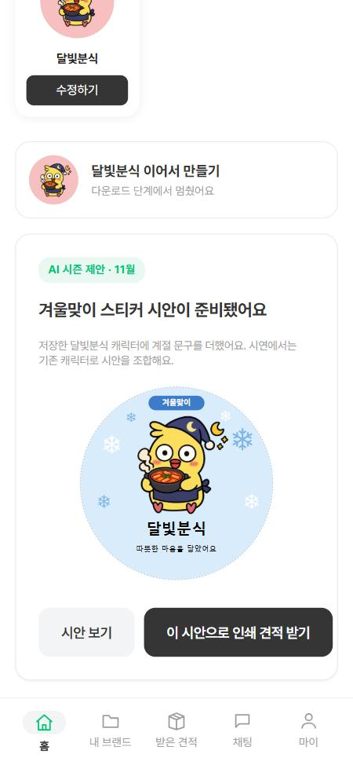

저장한 캐릭터에 다가오는 시즌(화이트데이, 어버이날, 여름, 핼러윈, 겨울맞이, 크리스마스)의 바탕색·장식·리본을 더해 시안을 제안함. 그대로 인쇄 견적을 받을 수 있음.

## 사용 흐름

- **사장님**: 가게 소개 4단계 → AI 캐릭터와 슬로건 → 스티커·포장·홍보물 꾸미기 → 인쇄 파일 승인 → 견적 요청 → 인쇄소 고르기 → 결제 → 진행 상황 확인, 채팅
- **인쇄소**: 가입, 관리자 승인 → 새 요청 찾기 → 견적 보내기 → 제작, 배송 상황 올리기
- **관리자**: 인쇄소 승인, 계정별 AI 켜고 끄기, 체험 계정에 온 무료 충전

## 주요 기능

**캐릭터, 스티커**

- 질문 4단계: 가게 이름·업종 → 분위기 10가지 중 고르기 → 자랑거리 → 선호 색(최대 3개)·질감·참고 사진.
- 캐릭터는 시디과 학생이 그린 그림체를 참고 이미지로 보내 그 그림체로 그림. 그림체는 처음 고른 분위기로 정해지고, 질감 6종을 고르면 그 재질로 그림.
- 음식·상품 사진을 올리면 그 사진을 스티커 원본으로 바로 씀(AI 그림 대신).
- 스티커 요소(캐릭터, 상호명, 문구)를 끌어 옮기고 크기·회전을 바꿈. 색상 선택창, 글꼴 12종, 배치 5가지.

**인쇄소 연결**

- 사장님이 요청을 올리면 인쇄소들이 견적을 보내고, 사장님이 하나 고름. 디자인 원본은 고른 인쇄소만 볼 수 있음.
- 50mm 원형 스티커는 인쇄 이미지와 칼선을 나눈 PDF(76×76mm, 재단 70×70mm)를 만들고 300ppi 미만은 막음. 자세한 규격은 [docs/STICKER_PRINT.md](docs/STICKER_PRINT.md).
- 1:1 채팅(사진 포함), 제작·배송 단계와 송장번호, 모의 결제(실제 과금 없음), 후기와 별점.
- 새 인쇄소는 관리자가 국세청에서 사업자 상태를 확인하고 승인해야 견적을 보낼 수 있음.

**수익 모델 (시연)**

- 재화 이름은 **온**. 새 브랜드 30온, 스티커·홍보물 10온(편집·미리보기는 무료, 저장·다운로드·견적 제출 때 작업당 한 번).
- 요금제는 무료·라이트·프로. 프로는 정기배송, 시즌 시안 무료.
- 인쇄소 수수료 8%, 사장님 이용료 0원. 재주문, 정기배송, 시즌 시안까지 모의 주문으로 시연. 가격은 `pricing.js`, 시연 순서는 [docs/COMMERCE_DEMO.md](docs/COMMERCE_DEMO.md).

**그 밖에**

- 휴대폰 홈 화면에 앱처럼 설치(PWA). 앱을 닫아 둬도 새 견적, 채팅, 진행 상황이 폰 알림으로 옴.
- 남의 요청, 견적, 채팅은 DB 권한 규칙(RLS)으로 막음. 화면에서만 숨긴 게 아님.
- AI는 부를 때마다 요금이 나가서 관리자가 켜 준 계정만 실제로 생성함. 켠 계정은 하루 횟수 제한 없음. 나머지 계정은 예시 캐릭터로 동작하고 "예시"라고 표시됨.
- AI가 실패하면 원인(크레딧 부족, 요청 몰림, 안전 기준, 시간 초과, 연결 끊김)을 화면에 알려 줌.

이미지 생성은 LoRA 학습도 실험해 봤지만 OpenAI + 참고 이미지 방식을 골랐음. 과정과 이유는 [docs/IMAGE_GENERATION.md](docs/IMAGE_GENERATION.md).

## 구조

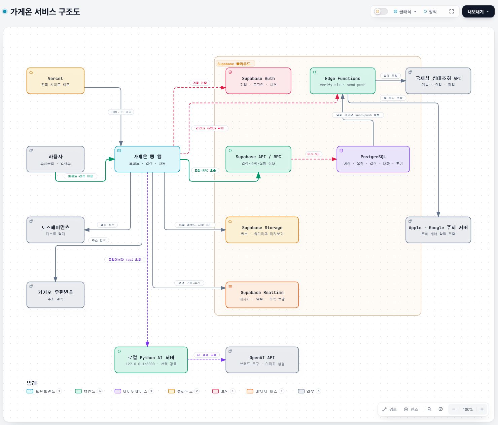

웹사이트는 Vercel. 로그인, 데이터, 채팅, 파일은 Supabase. AI는 Supabase 함수 `ai`(휴대폰, Vercel) 또는 노트북 서버(`server.py`)를 거쳐 OpenAI로 감. 쓴 외부 서비스와 API는 [docs/API.md](docs/API.md).

```text
index.html            껍데기 (파일 불러오기만 함)
app.js                첫 화면, 홈, 캐릭터 만들기, 스티커
sticker-editor.js     스티커 요소 편집, 색상 선택, 글꼴 넘기기
sticker-print*.js     50mm 원형 스티커 인쇄 파일 (PDF, ZIP)
print.js              인쇄 요청, 견적, 주문상세, 결제, 관리자, 알림, 마이페이지
chat.js               1:1 채팅
commerce*.js          온, 요금제, 모의 주문, 시즌 시안
pricing.js            온 가격, 요금제, 시즌 목록
style.css             화면 스타일
server.py             노트북 AI 서버
supabase/             DB 표, 권한 규칙, DB 함수(번호 순서대로 적용), 서버 함수(ai, send-push, verify-biz)
assets/               로고, 첫 화면·홈 그림, 그림체·질감 참고 이미지
docs/screens/         이 README의 화면 캡처
scripts/              관리자 계정 만들기, 시연 전 데이터 정리 SQL 등
```

## 실행

Python 3.10 이상만 있으면 됨. 따로 설치할 패키지 없음.

```powershell
python server.py
```

키를 물어보면 OpenAI API 키를 넣고(없으면 Enter로 예시 모드), 브라우저로 [127.0.0.1:8000](http://127.0.0.1:8000) 접속. 자세한 건 [SERVER.md](SERVER.md).

테스트:

```powershell
python -m unittest -v test_server.py test_textures.py
node --test tests/sticker-editor.test.cjs tests/commerce.test.cjs tests/commerce-exports.test.cjs tests/commerce-flow.test.cjs tests/sticker-print.test.cjs tests/textures.test.cjs
```

## 운영 메모

- **새 SQL**: `supabase/` 파일을 번호 순서대로 Supabase SQL Editor에서 한 번씩 실행. 최근 것은 16(인쇄 ZIP 업로드), 17(관리자 온 충전), 18(AI 하루 제한 해제).
- **AI 함수**: `supabase/functions/ai/index.ts`를 고치면 Supabase → Edge Functions → `ai` → Code에 붙여넣고 Deploy.
- **시연 전 정리**: `scripts/demo_cleanup.sql`로 체험 계정의 연습 요청·채팅·알림을 지우고 시연용 주문 5개만 남김(먼저 ① 확인만 실행해 보고 ② 정리 실행).
- **배포**: main에 올리면 Vercel이 자동 배포. 팀원 커밋이 맨 위면 Vercel이 막으니 저장소 주인 이름으로 커밋을 하나 더 올림.

## 쓴 기술

- 화면: HTML, CSS, JavaScript (프레임워크 없음), Pretendard, [Astryx](https://github.com/meta/astryx) 테마 색
- 서버, 데이터: Supabase (PostgreSQL, Auth, Storage, Realtime, Edge Functions), Python 표준 라이브러리
- AI: OpenAI 이미지, 글 API
- 배포: Vercel, GitHub Actions

## 문서

- [GUIDE.md](GUIDE.md): 팀원용 써 보기 가이드
- [SERVER.md](SERVER.md): 노트북 AI 서버
- [ADMIN.md](ADMIN.md): 관리자 계정, 인쇄소 승인, 국세청 확인, 푸시 알림, AI 켜기 설정
- [docs/API.md](docs/API.md): 쓴 외부 서비스, 서버 요청, DB 함수
- [docs/COMMERCE_DEMO.md](docs/COMMERCE_DEMO.md): 온·요금제·모의 주문 시연 순서
- [docs/STICKER_PRINT.md](docs/STICKER_PRINT.md): 50mm 원형 스티커 인쇄 규격
- [docs/CHARACTER_TEXTURES.md](docs/CHARACTER_TEXTURES.md): 캐릭터 질감 6종
- [docs/IMAGE_GENERATION.md](docs/IMAGE_GENERATION.md): 이미지 생성 방식을 정한 과정 (LoRA 실험)

## 시연 뒤에 할 것

- AI 금액 한도, 실제 결제, 토큰(온) 계산을 서버로 옮기기.
- 캐릭터 생성 중 연결이 끊겨도 결과를 다시 받아오기.
- 노트북 서버와 `ai` 함수에 겹친 프롬프트 하나로 합치기.
- 개인정보 처리방침, 회원 탈퇴 직접 하기.
