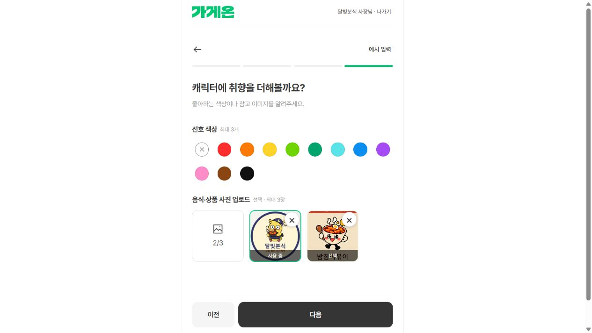

# 음식·상품 사진으로 스티커 만들기

- 질문 마지막의 업로드 사진마다 오른쪽 위 × 삭제 버튼을 표시한다.
- 최대 3장을 보관하며 사진을 누르면 사용할 원본을 선택한다. 사진은 작업 상태에 저장한다.
- 사진이 있으면 캐릭터 생성 요청과 생성 온 차감을 건너뛰고, 선택 사진을 스티커 원본으로 사용한다.
- 사진 적용은 무료다. 저장·다운로드 등 기존 편집 사용료 규칙은 유지한다.
- AI 배경 제거는 별도 버튼으로 실행한다. 기존 이미지 생성 비용(30온)을 사용하며 실패하면 온을 반환하고 원본을 유지한다.
- 배경 제거는 이미지 편집 API를 사용한다. 음식의 실사 모습을 유지하고 배경을 제거하도록 요청한다. 생성형 편집 특성상 음식의 세부 표현이 달라질 수 있으므로 원본 복원 버튼을 제공한다.
- 이전 서버가 캐릭터 결과를 반환하면 `image_mode: food` 확인으로 적용을 거부한다.

## 배포

프런트엔드는 기존 웹 배포를 사용한다. 온라인 AI 배경 제거에는 업데이트된 Supabase `ai` 함수를 배포해야 한다. Python 로컬 서버는 변경된 `server.py`로 재시작한다. SQL 변경은 없다. 사진 직접 적용은 AI 함수 업데이트 없이 사용할 수 있다.

## 검증

`node --test tests/*.test.cjs`

`python -m unittest test_server test_compare test_food_photo`

사진 선택·삭제·직렬화, 캐릭터 생성 차단, 배경 제거 실패/성공, 이전 서버 응답 차단, Python/Edge 이미지 편집 요청을 검사한다. 외부 유료 AI 호출 없이 모의 응답으로 검증했다.

브라우저에서 예시 이미지를 업로드 상태로 준비해 × 삭제, 사진 수 변경, 다음 단계 스티커 미리보기를 확인했다. 파일 선택기 자동화는 브라우저 연결 오류로 완료하지 못했다. 아래 화면은 실제 음식 사진이 아닌 UI 검증용 예시 이미지다.

